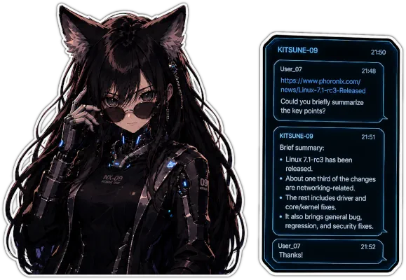

# Telegram LLM Bot

[](https://ci.skobk.in/skobkin/telegram-ollama-reply-bot)



## Functionality

- Context-dependent dialogue in chats
- Summarization of articles by provided link (SSRF-protected fetching, quality-scored extraction backends, Markdown output)
- Optional per-chat auto-summarizer mode: linked long-form articles in ordinary chat messages are summarized automatically
- Reactions to the bot's messages are recorded in conversation history and shown to the model as per-user feedback
- Optional live tool-execution previews while a reply is being generated (temporary message in groups, message draft in private chats), with a collapsible tool-history section appended to the final reply
- Image recognition and description
- Tool-assisted free-form chat with
  - URL retrieval
  - Optional external web search
  - History lookup
  - Summary lookup
  - Current-time lookup
  - Poll creation
  - Durable reminders
- Optional [Model Context Protocol](https://modelcontextprotocol.io) (MCP) servers that publish additional tools at startup (Streamable HTTP transport)

## Configuration

The bot can be configured using the following environment variables:

| Variable                                            | Description                                                                                                       | Required | Default                  |
|-----------------------------------------------------|-------------------------------------------------------------------------------------------------------------------|----------|--------------------------|
| `BOT__TELEGRAM__TOKEN`                              | Telegram Bot API token                                                                                            | Yes      | -                        |
| `LLM__BACKENDS__OPENAI_COMPAT__BASE_URL`            | Base URL for OpenAI-compatible backend                                                                            | No       | empty                    |
| `LLM__BACKENDS__OPENAI_COMPAT__API_TOKEN`           | API token for OpenAI-compatible backend                                                                           | No       | empty                    |
| `LLM__FEATURES__CHAT__MODEL`                        | Model name for normal chat requests                                                                               | Yes      | -                        |
| `LLM__FEATURES__SUMMARIZE__MODEL`                   | Model name for summarization                                                                                      | No       | chat model               |
| `LLM__FEATURES__IMAGE_RECOGNITION__MODEL`           | Model name for image recognition                                                                                  | No       | chat model               |
| `LLM__TOOL_LOOP_MAX_ITERATIONS`                     | Maximum tool-use loop iterations for one conversational reply                                                     | No       | `6`                      |
| `LLM__IMAGE_RECOGNITION_ENABLED`                    | Toggle image recognition. Set to `false` to treat images as placeholders without making vision model calls.       | No       | `true`                   |
| `LLM__IMAGE_RECOGNITION__RECOGNIZER`                | Image-recognition back-end: `openai_compat` (multimodal chat model) or `minimax_vlm` (MiniMax Coding Plan VLM).   | No       | `openai_compat`          |
| `LLM__IMAGE_RECOGNITION__MAX_IMAGE_BYTES`           | Client-side bound on downloaded image size in bytes (this bot's own choice; see the back-ends section).            | No       | `10485760`               |
| `LLM__IMAGE_RECOGNITION__MINIMAX_VLM__BASE_URL`     | MiniMax VLM endpoint base URL (`https://api.minimax.io` global, `https://api.minimaxi.com` China; must match key). | No       | `https://api.minimax.io` |
| `LLM__IMAGE_RECOGNITION__MINIMAX_VLM__API_KEY`      | MiniMax API key. Required when the recognizer is `minimax_vlm`; never inherited from the OpenAI-compatible token.  | No       | -                        |
| `LLM__IMAGE_RECOGNITION__MINIMAX_VLM__TIMEOUT`      | Per-request timeout for MiniMax VLM calls. Accepts Go duration strings.                                            | No       | `60s`                    |
| `LLM__IMAGE_RECOGNITION__OPENAI_COMPAT__BASE_URL`   | Optional dedicated OpenAI-compatible endpoint for image recognition. Empty reuses the conversational backend.      | No       | empty                    |
| `LLM__IMAGE_RECOGNITION__OPENAI_COMPAT__API_TOKEN`  | Token for the dedicated image endpoint. Only valid together with its `BASE_URL`.                                  | No       | empty                    |
| `STATE__MAX_BYTES`                                  | Soft total in-memory state budget in bytes                                                                        | No       | `268435456`              |
| `STATE__HISTORY_MAX_BYTES`                          | Soft history bucket budget in bytes                                                                               | No       | `167772160`              |
| `STATE__HISTORY_STREAMS_MAX`                        | Maximum number of active conversation scopes kept in RAM                                                          | No       | `1024`                   |
| `STATE__IMAGE_CACHE_MAX_BYTES`                      | Maximum image-description cache size in bytes                                                                     | No       | `67108864`               |
| `STATE__IMAGE_CACHE_TTL`                            | TTL for cached image descriptions. Accepts Go duration strings (e.g. `1h`, `24h`).                                | No       | `24h`                    |
| `LLM__UNCOMPRESSED_HISTORY_LIMIT`                   | Recent chat messages sent verbatim to LLM; older ones summarized. Set to `0` to disable summarization             | No       | 15                       |
| `LLM__HISTORY_SUMMARY_THRESHOLD`                    | Extra messages beyond the limit before summarization triggers again                                               | No       | 5                        |
| `BOT__PROCESSING_TIMEOUT`                           | Timeout for processing incoming requests (includes LLM calls). Accepts Go duration strings (e.g. `45s`, `1m30s`). | No       | `30s`                    |
| `BOT__AUTO_SUMMARY__MIN_TEXT_LENGTH`                | Minimum extracted article length (in runes) for the auto-summarizer to summarize a link.                          | No       | `2000`                   |
| `BOT__AUTO_SUMMARY__URL_COOLDOWN`                   | How long a URL stays suppressed per chat after an automatic summary. Go duration string.                          | No       | `12h`                    |
| `BOT__AUTO_SUMMARY__MAX_LINKS_PER_MESSAGE`          | How many distinct links of one message the auto-summarizer processes.                                             | No       | `3`                      |
| `SEARCH__BACKEND`                                   | External search backend for the `search_web` tool: `none`, `tavily`, `kagi`, or `chain`                           | No       | `none`                   |
| `SEARCH__CHAIN`                                     | Comma-separated backend order used when `SEARCH__BACKEND=chain`                                                   | No       | empty                    |
| `CONTENT__FETCH__TIMEOUT`                           | Whole-exchange budget per article fetch (dial to last body byte). Go duration string.                             | No       | `10s`                    |
| `CONTENT__FETCH__MAX_BODY_BYTES`                    | Maximum decoded response body size per fetched page in bytes.                                                     | No       | `2097152`                |
| `CONTENT__FETCH__MAX_REDIRECTS`                     | Maximum redirects followed per fetch; exceeding it fails the fetch.                                               | No       | `5`                      |
| `CONTENT__FETCH__USER_AGENT`                        | User-Agent sent with article fetch requests.                                                                      | No       | Firefox-like desktop UA  |
| `CONTENT__FETCH__DENY_DOMAINS`                      | Comma-separated domains (with subdomains, IDN supported) blocked in addition to the built-in SSRF policy.          | No       | empty                    |
| `CONTENT__FETCH__DENY_CIDRS`                        | Comma-separated IPv4/IPv6 addresses or CIDR ranges blocked in addition to the built-in SSRF policy.               | No       | empty                    |
| `CONTENT__EXTRACT__BACKENDS`                        | Comma-separated extraction backend order: `readability`, `trafilatura`, or `domdistiller`. The listed order is the base order and tiebreak — the bot may re-rank it per page (see UPGRADE.md). | No       | `readability,trafilatura,domdistiller` |
| `PROVIDERS__TAVILY__API_KEY`                        | Tavily provider API key                                                                                           | No       | empty                    |
| `PROVIDERS__KAGI__API_KEY`                          | Kagi provider API key                                                                                             | No       | empty                    |
| `LOG__LEVEL`                                        | Structured log verbosity: `debug`, `info`, `warn`, or `error`                                                     | No       | `info`                   |
| `SENTRY__DSN`                                       | Sentry DSN for error tracking                                                                                     | No       | empty                    |
| `PERSISTENT__STORE_PATH`                            | Path to the SQLite database used for durable bot data                                                             | No       | `/data/db.sqlite`        |
| `BOT__ADMIN_IDS`                                    | Comma-separated list of admin user IDs                                                                            | No       | empty                    |
| `BOT__DM_ADMINS_ONLY`                               | When `true`, private-chat messages from non-admin users are silently dropped before any processing (history, catalog, stats, commands, LLM). Group chats are unaffected. With an empty `BOT__ADMIN_IDS` this drops **all** private messages. | No       | `false`                  |
| `MCP__ENABLED`                                     | Master switch for MCP tool servers; tools are registered only when `true`                                         | No       | `false`                  |
| `MCP__SERVERS__<NAME>__URL`                        | Streamable HTTP endpoint of an MCP server (e.g. `https://mcp.example.com/mcp`)                                    | No       | empty                    |
| `MCP__SERVERS__<NAME>__HEADERS__<SEG>[__<SEG>...]` | HTTP header sent to that MCP server (e.g. `Authorization=Bearer …`). Values are never logged.                     | No       | empty                    |
| `MCP__SERVERS__<NAME>__INSECURE`                   | Allow plain `http://` for this server. Required for local development.                                            | No       | `false`                  |
| `MCP__SERVERS__<NAME>__TIMEOUT`                    | Per-tool-call timeout. Go duration string (e.g. `30s`); caps tool calls, not the standing connection.             | No       | `15s`                    |
| `MCP__SERVERS__<NAME>__INVOCATION_POLICY`          | Default invocation policy for this server: `discretionary`, `discretionary_paid`, or `explicit_request_only`      | No       | derived from `readOnlyHint` |
| `MCP__SERVERS__<NAME>__SIDE_EFFECTING`             | Force `true`/`false` for the side-effecting flag of every tool from this server                                   | No       | derived from `destructiveHint` |
| `MCP__SERVERS__<NAME>__RESULT_CHAR_BUDGET`         | Maximum characters of a tool result forwarded to the model. Must be a positive integer when set.                  | No       | `3500`                   |
| `MCP__SERVERS__<NAME>__ALLOWED_TOOLS`              | Comma-separated whitelist of tool names to expose from this server. Misnamed entries fail at startup.             | No       | empty                    |
| `MCP__SERVERS__<NAME>__RESTRICTED_TOOLS`           | Comma-separated deny-list of tool names to drop from this server. Misnamed entries fail at startup.               | No       | empty                    |
| `MCP__SERVERS__<NAME>__OPTIONAL`                   | When `true`, a connection failure on startup is logged and skipped instead of aborting the bot                    | No       | `false`                  |

### Prompt and persona management

Prompt templates, response language, character name, tone mode, interactivity mode, whitelist rules, and per-chat
overrides are now stored in SQLite and managed from Telegram admin DMs.

Stored prompt templates use Go's [`text/template`](https://pkg.go.dev/text/template) placeholders:

- `chat` – `{{.Model}}`, `{{.Language}}`, `{{.Gender}}`, `{{.CharacterName}}`, `{{.ToneMode}}`, `{{.AllowTeasing}}`, `{{.Context}}`, `{{.ToolPolicy}}`
- `summarize` – `{{.Language}}`, `{{.MaxLength}}`
- `image_recognition` – `{{.Language}}`

Global fields: `character_name`, `language`, `gender`, `tone_mode`, `allow_teasing`, `default_interactivity_mode`, `default_auto_summary_enabled`, `show_reply_previews`, `default_preview_mode`, `keep_tool_history`.
Per-chat fields: `character_name`, `language`, `gender`, `tone_mode`, `allow_teasing`, `interactivity_mode`, `auto_summary_enabled`, `preview_mode`, `keep_tool_history`.

## Usage

The bot supports the following commands:

| Command            | Description                               | Example                                                                                  |
|--------------------|-------------------------------------------|------------------------------------------------------------------------------------------|
| `/start`           | Start the bot and get a welcome message   | `/start`                                                                                 |
| `/help`            | Show help message with available commands | `/help`                                                                                  |
| `/summarize`, `/s` | Summarize text from the provided link     | `/summarize https://ex.co/article`, `/s https://ex.co/article concentrate on tech stuff` |
| `/stats`           | Show bot statistics (admin only)          | `/stats`                                                                                 |
| `/reset`           | Reset current chat history (admin only)   | `/reset`                                                                                 |
| `/admin`           | Open the interactive admin panel          | `/admin` (admin DMs only)                                                                |

You can also interact with the bot by:
- Mentioning it in a message
- Replying to its messages
- Sending direct messages in private chat when interactivity is enabled for that chat
- Sending images (the bot will describe what it sees in the image)

Ordinary chat replies always use the tool-capable chat workflow. `LLM__FEATURES__CHAT__MODEL` must point to a model and backend combination that supports OpenAI-compatible tool calls. The current tool set is:

- `search_web` for explicit internet lookups when `SEARCH__BACKEND` is configured to something other than `none`
- `get_current_time` for time-sensitive reasoning and schedule anchoring
- `datetime_math` for exact datetime diff, shift, weekday, and timezone conversion
- `datetime_format` for compact user-facing timestamp formatting
- `fetch_url_content` for explicit link-analysis requests in free-form chat (returns the article as Markdown when structure is available)
- `list_recent_images` for identifying recent image-bearing messages by `message_id` in the current chat/topic (while image recognition is enabled)
- `analyze_image` for re-analyzing one of those images under the model's own focused prompt (while image recognition is enabled; each call is a paid recognition request)
- `search_history` for indexed keyword and fuzzy full in-memory history lookup in the current chat/topic
- `get_conversation_summary` for the current in-memory earlier summary
- `get_chat_activity_window` for in-memory message cadence heuristics in the current chat/topic
- `get_history_bounds` for exact full-history and recent-history coverage in the current chat/topic
- `get_message_thread_context` for compact reply-chain reconstruction when an older replied-to message has scrolled out of the recent verbatim context
- `send_poll` for explicit vote/poll requests
- `send_quiz` for explicit quiz and trivia requests
- `send_dice` for explicit dice-roll and mini-game requests
- `list_chat_schedule`, `add_schedule_item`, `remove_schedule_item` for durable chat reminders

### External MCP tools

The bot can also expose tools published by external [Model Context Protocol](https://modelcontextprotocol.io) (MCP)
servers over Streamable HTTP. Each configured server is connected at startup, its `tools/list` is fetched, and
each remote tool is registered under the namespaced name `mcp_<server>__<tool>` (lowercased and `[a-z0-9_]`-normalized).
The LLM sees MCP tools alongside the built-ins; tool calls are routed back to the originating server.

MCP is disabled by default: tools are registered only when `MCP__ENABLED=true`. When the flag is `false` but servers
are still configured, the bot logs a warning at startup and runs without MCP tools. While disabled, per-server
validation is skipped, so a forgotten enable flag cannot block boot.

Header values are never written to logs. Header names are given as path segments after `HEADERS` and joined with `-`:
`MCP__SERVERS__BROWSER__HEADERS__X__API__KEY=v` sends the header `X-Api-Key`. A single segment keeps its literal
underscores, so `MCP__SERVERS__BROWSER__HEADERS__X_API_KEY=v` sends `X_Api_Key`.

A worked example: a hosted browser/search MCP server with bearer-token auth, only exposing two specific tools:

```env
MCP__ENABLED=true
MCP__SERVERS__BROWSER__URL=https://mcp.example.com/mcp
MCP__SERVERS__BROWSER__HEADERS__AUTHORIZATION=Bearer secret-token
MCP__SERVERS__BROWSER__TIMEOUT=120s
MCP__SERVERS__BROWSER__ALLOWED_TOOLS=fetch_url,summarize_page
```

A local development server (plain HTTP, fail-soft):

```env
MCP__ENABLED=true
MCP__SERVERS__LOCAL__URL=http://localhost:8765/mcp
MCP__SERVERS__LOCAL__INSECURE=true
MCP__SERVERS__LOCAL__OPTIONAL=true
```

Startup behaviour:

- If a server's `URL` is unreachable, the bot fails to start unless `OPTIONAL=true` is set for that server.
- Entries in `ALLOWED_TOOLS` or `RESTRICTED_TOOLS` that the server does not advertise are a hard startup error
  for non-optional servers (catches typos early).
- `TIMEOUT` caps each individual tool call (default `15s`, no upper limit; slow tools such as browser automation
  can use `120s` or more). It does not cap the standing connection to the server.
- `RESULT_CHAR_BUDGET` caps how many characters of a tool result are forwarded to the model (default `3500`).
  It must be a positive integer when set; values `<= 0` are a startup configuration error.
- Tool invocation policy defaults to `discretionary` when the server's tool annotation sets `readOnlyHint=true`,
  and `explicit_request_only` otherwise. `discretionary_paid` behaves like `discretionary` but tells the model to
  reserve the tool for calls that need accuracy or freshness, since each call consumes a paid external resource.
  The default side-effecting flag is `destructiveHint` (treated as `true`
  when the annotation is absent), and is forced to `false` whenever `readOnlyHint=true` per the MCP spec.
- `INSECURE=true` is required to use a `http://` URL. HTTPS is the default and is enforced per server.

Reminder behavior in the first implementation slice:

- one-shot reminders use an exact RFC3339 timestamp internally
- recurring reminders support `interval_days`, `interval_weeks`, weekday rules, and monthly rules
- calendar-based reminders require an IANA timezone such as `Europe/Moscow`
- reminders survive restarts and are delivered back into the original chat topic when `topic_id` is present
- after downtime, recurring reminders emit only the latest missed occurrence and then continue on schedule

`/summarize` still uses the direct extractor-plus-summary workflow and does not depend on the tool loop.

If `SEARCH__BACKEND` is unset or set to `none`, the `search_web` tool is not exposed to the model.

By default, chat interactivity is `disabled`. Configure it from an admin DM before expecting the bot to answer normal
chat messages.

### DM restrictions

`BOT__DM_ADMINS_ONLY=true` makes private chats admin-only: messages from users not listed in
`BOT__ADMIN_IDS` are silently dropped before any side effect — they are not stored in history,
cataloged, counted, or answered, and no command (including `/summarize`) runs for them. Group and
supergroup chats are never affected; whitelist and interactivity rules keep applying there as
before. Because admins are identified solely by `BOT__ADMIN_IDS`, enabling this flag with an empty
`BOT__ADMIN_IDS` drops **all** private messages, including admin commands.

### Auto-summarizer

The auto-summarizer is an optional per-chat mode: when enabled for a chat, the bot watches **ordinary** chat messages
(the ones it would otherwise ignore), and when such a message contains one or more links to long-form content, it
fetches the article and posts an automatic summary as a reply to the linking message.

- **Enable it per chat** from the admin UI (chat card or chat settings, `Auto summary`), or flip the global default
  (`Default auto summary`) and let chats inherit it. The feature is off everywhere by default.
- The mode is **independent of the interactivity mode**: a chat with interactivity `disabled` but auto-summary on still
  gets automatic summaries. Messages the bot already answers conversationally (mentions, replies to it, private DMs)
  are never auto-summarized — no double answers. As a consequence, fully interactive private chats never trigger it.
- Content counts as "long" at `BOT__AUTO_SUMMARY__MIN_TEXT_LENGTH` runes (default `2000`); shorter articles are
  skipped without a model call. Markdown extraction is preferred for the summary, falling back to plain text.
- The per-message link budget is `BOT__AUTO_SUMMARY__MAX_LINKS_PER_MESSAGE` (default `3`); each distinct qualifying
  link gets its own summary reply.
- A per-chat, in-memory URL cooldown (`BOT__AUTO_SUMMARY__URL_COOLDOWN`, default `12h`) suppresses reposts of the same
  link. It resets on restart. Failed attempts release the cooldown so a repost can retry; deliberately skipped
  (too-short) links stay suppressed.
- Failures are silent: automatic summaries never post error messages, they are only logged (and reported to Sentry).
- The `/stats` summarize counter includes automatic runs.
- **Telegram privacy mode matters**: with BotFather privacy mode enabled, the bot never receives ordinary group
  messages at all, so the mode silently no-ops in groups. Disable privacy mode for the bot (or promote it to a group
  admin) for auto-summarizer use.

### Reactions on bot replies

The bot watches for reactions to its own messages and stores them on the conversation history entry, so later replies
can take the feedback into account. The next model request sees each bot message that carries reactions with reactor
names, e.g. `[reactions: 👍 Alice, 👎 Bob]`, and the same rendering feeds history summaries, so the signal survives
compaction.

- Receive-only: the bot never sets reactions itself.
- A fixed set of common emoji is tracked (chosen for model comprehension); other simple emoji, premium custom emoji,
  and paid reactions are ignored. The set is not configurable.
- **Group chats require the bot to be an administrator** — Telegram delivers per-user reaction updates to admin bots
  only; without that, reactions are silently unavailable. Private chats work as-is. Chats blocked by the whitelist or
  DM restrictions are ignored for reactions too.
- Reaction changes and removals are applied per user; after a restart, a history reset, or history trimming, older
  replies can no longer be matched and such reactions are dropped (logged at DEBUG level).

### Live reply previews

While the bot works on a reply, chats can show a live progress preview: a neutral indicator plus the list of tool
calls as they start and finish. It never contains answer text or tool payloads — only tool names, their outcome,
and (in the widest mode) how long each call took.

- **Groups and supergroups** get a temporary silent message replying to the trigger message, updated in place and
  deleted after the final reply has been delivered. Short runs (under ~1.5 seconds) never create one at all.
- **Private chats** get a rich-message draft in the message input area (the ephemeral "typing a draft" surface).
  The draft is refreshed internally so it stays alive during long runs and is dismissed by the final reply itself;
  if drafts are unavailable, the plain typing indicator takes over.
- Wire updates are paced per chat: a minimum spacing per run plus a shared per-chat backoff after Telegram rate
  limits, so several concurrent requests in one chat do not flood the API (one run hitting the limit delays the
  others' preview updates, not their execution). After repeated delivery failures the preview for that run disables
  itself and the typing indicator takes over; the final reply is never affected.
- **Modes** (per chat, with a global default):
  - `off` — no preview; the plain typing indicator as before. Forced whenever the master switch is off.
  - `tools` — standard user-facing tools only (search, URL fetching, history and media lookups, polls, reminders,
    time utilities, MCP tools).
  - `all_tools` — additionally shows the bot's internal context-management helpers and per-tool execution durations.
- When previews are active, the final reply appends a collapsible **tool history** section (`Tool calls (N)`) built
  from the same data — compacted or omitted when the answer needs the space, and never recorded into conversation
  history. `Keep tool history` (global, with a per-chat override) turns the section off without touching previews.
- Settings live in the admin UI: global `Show reply previews` (master switch, off by default), `Default preview
  mode`, `Keep tool history`, and per-chat overrides for both mode and retention. With the master switch off, chat
  screens hide the preview rows; stored overrides survive re-enabling.
- LLM token streaming (partial answer text inside the preview) is planned as a follow-up; previews currently show
  only progress indicators and tool execution events.

### Admin UI

Administration is a Telegram-native interactive panel. Send `/admin` in a private chat with the bot (users listed in
`BOT__ADMIN_IDS` only) to open the dashboard; every screen is inline buttons — no commands to memorize. `/cancel`
dismisses a pending input and reopens the panel. Sessions are ephemeral and expire after 30 minutes of inactivity.

- **Chats** — searchable catalog (8 per page, filter by groups/private). The chat card shows effective access,
  interactivity, and settings; interactivity modes switch right on the card, `Inherit global` clears a chat override,
  and `Reset overrides` (confirmed) clears everything the card overrides.
- **Auto-summary toggle** — per chat (`Auto summary`, tri-state with inherit) and global (`Default auto summary`),
  edited like any other boolean field.
- **Preview settings** — global (`Show reply previews` master switch, `Default preview mode`, `Keep tool history`)
  and per-chat (`Preview mode` enum with explicit inherit while overridden, `Keep tool history` tri-state). While
  the master switch is off, chat screens hide the preview rows — stored overrides stay untouched.
- **Global settings / chat settings** — one editor per field: enum and boolean fields are buttons; text fields ask for
  a reply (three attempts on invalid input, then the input is cancelled).
- **Prompts** — per feature (chat, summarize, image recognition): view, download the active or built-in template,
  replace via text, or upload a `.txt`/`.md` file (UTF-8, at most 32 KiB). Reset-to-global (chat scope) and
  restore-built-in (global) are confirmed and visually marked as destructive.
- **Access** — the explicit policy (`allowlist`, the default, or `allow_all`), allowlisted chats with removal
  (confirmed), and Add chat: a native chat picker (the bot does not need to be a member) or a numeric chat ID;
  unreachable chats are added as "unverified".
- **Statistics** — the same usage stats as `/stats`.

Access is never conflated with membership: each chat card shows one of four states — `allowlisted`,
`blocked (allowlist policy)`, `allowlisted (policy already allows all)`, or `allowed via allow_all (not allowlisted)`.
Switching the policy never modifies allowlist membership, and reminder delivery follows the same policy: reminders for
denied chats are skipped (schedules advance), while reminders to admin DMs always deliver.

The legacy IRC-style admin commands were removed; typing one is silently ignored. Unknown `/commands` are dropped in
all chats and never reach the model.

## Running

### Local build

```shell
go build -o /tmp/telegram-ollama-reply-bot ./cmd/bot
```

### Lint

```shell
golangci-lint run ./cmd/bot/... ./internal/...
```

### Docker

```shell
docker run \
  -e BOT__TELEGRAM__TOKEN=12345 \
  -e LLM__BACKENDS__OPENAI_COMPAT__BASE_URL=http://ollama.localhost:11434/v1 \
  -e LLM__BACKENDS__OPENAI_COMPAT__API_TOKEN=dummy \
  -e LLM__FEATURES__CHAT__MODEL=gemma4:e4b \
  -e PERSISTENT__STORE_PATH=/data/db.sqlite \
  -e STATE__HISTORY_STREAMS_MAX=1024 \
  -e STATE__IMAGE_CACHE_TTL=24h \
  -e LLM__UNCOMPRESSED_HISTORY_LIMIT=15 \
  -e LOG__LEVEL=info \
  -e SENTRY__DSN=https://your-sentry-dsn \
  -e BOT__ADMIN_IDS=123456789,987654321 \
  -e MCP__ENABLED=true \
  -e MCP__SERVERS__BROWSER__URL=https://mcp.example.com/mcp \
  -e MCP__SERVERS__BROWSER__HEADERS__AUTHORIZATION="Bearer secret-token" \
  -v bot-data:/data \
  skobkin/telegram-llm-bot
```

The conversational LLM uses only the OpenAI-compatible API. For Ollama deployments, use Ollama's `/v1` OpenAI-compatible endpoint rather than the native Ollama API.

`LLM__FEATURES__SUMMARIZE__MODEL` and `LLM__FEATURES__IMAGE_RECOGNITION__MODEL` normally inherit `LLM__FEATURES__CHAT__MODEL`.
Set them only when you intentionally want summarization or image recognition to use different models.

### Image recognition back-ends

Image recognition is extracted behind its own recognizer layer and supports two back-ends, selected with
`LLM__IMAGE_RECOGNITION__RECOGNIZER`:

- **`openai_compat` (default)** — the multimodal chat model on the OpenAI-compatible backend (`LLM__FEATURES__IMAGE_RECOGNITION__MODEL`,
  inheriting the chat model). Optionally point recognition at a dedicated endpoint by setting
  `LLM__IMAGE_RECOGNITION__OPENAI_COMPAT__BASE_URL` (with an optional `API_TOKEN`); when unset, recognition shares the
  conversational connection. The startup model check verifies the image model against whichever connection actually
  serves it.
- **`minimax_vlm`** — the MiniMax Coding Plan VLM API (`POST /v1/coding_plan/vlm`, no model selection; the M Plan
  subscription tied to the key selects it). Requires `LLM__IMAGE_RECOGNITION__MINIMAX_VLM__API_KEY`, which is **never
  inherited** from the OpenAI-compatible token — recognition credentials for an unrelated endpoint must be set
  explicitly, and startup refuses the selection while the key is missing. The base URL must match the key's region
  (`https://api.minimax.io` global, `https://api.minimaxi.com` China). The VLM API bills per request; the response
  carries no token usage, so this route reports nothing to `/stats` usage accounting.

Both routes accept JPEG, PNG, and WebP only. The format is detected from the image's byte signature (not from Telegram
metadata or file names) — this is signature detection, not full image integrity validation; a corrupt image surfaces
as a recognition error. `LLM__IMAGE_RECOGNITION__MAX_IMAGE_BYTES` (default 10 MiB) is this bot's own conservative
client-side bound on downloads and recognition input: the MiniMax API documents no image size limit (its official
client transfers unbounded data), so no provider limit is claimed. The bound sits below Telegram's 20 MB bot file
download ceiling. The `LLM__IMAGE_RECOGNITION_ENABLED` switch keeps working as before for both back-ends.

#### Hybrid: cached baseline plus model-prompted re-analysis

The baseline flow is unchanged: images are described once with the operator-managed prompt and the text description is
cached and replayed in chat context. On top of that, while recognition is enabled, the model gets two tools:
`list_recent_images` (local listing of image-bearing messages by `message_id`) and `analyze_image` (a fresh recognition
of one retained image under the model's own focused prompt — e.g. "read the error text in the screenshot"). This works
with both back-ends and never requires the conversational model to accept images.

Image originals are **not stored locally**: the bot keeps only the bounded Telegram `file_id` reference inside the
ephemeral in-memory history and re-fetches bytes from Telegram on demand. An image leaves scope when its message is
trimmed from history or the process restarts — requests for it then fail predictably. A prompt-specific analysis is
never cached and never replaces the baseline description; each `analyze_image` call is one paid recognition request
(the MiniMax route reports no token usage for it). Resolution is scoped to the current chat/topic, the current message,
and its reply chain only.

### Docker Compose

An example Compose-based deployment is maintained in the existing stack repository:

https://git.skobk.in/skobkin/docker-stacks/src/branch/master/telegram-llm-bot
