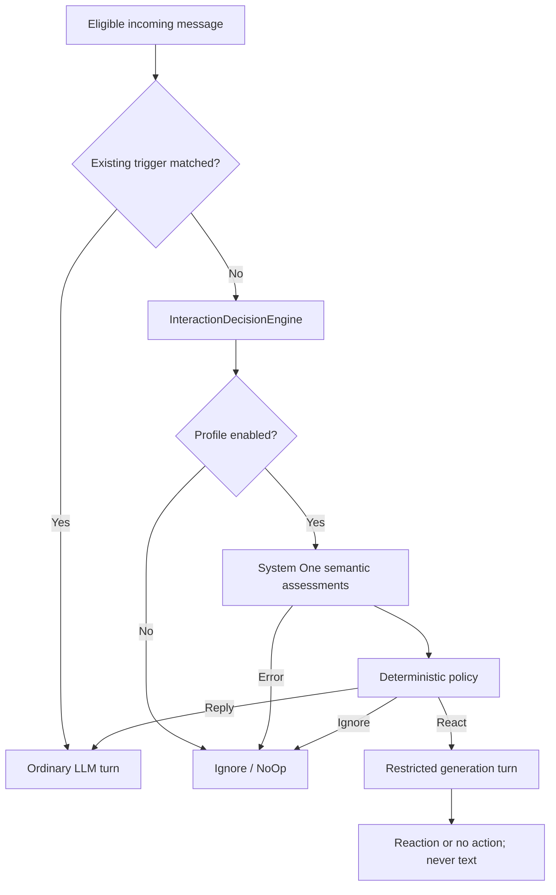

# Opt-in interactive participation

## 1. Goal and boundaries

Let the bot initiate a reaction or full conversational turn in an opted-in chat without asking the generation LLM to decide how frequently to participate. System One provides semantic evidence; deterministic Go policy selects the action. The normal generation LLM retains its existing persona, capabilities and tools. Privacy is primary. The bot is a personal service: evaluating every eligible message is an acceptable MVP; no throughput optimization campaign is required.

## 2. Public component contract

Use a separately testable `InteractionDecisionEngine` (exact package placement should follow repository conventions). Illustrative Go interface:

```go
type InteractionAction uint8
const (
    ActionIgnore InteractionAction = iota
    ActionReact
    ActionReply
)

type ActionDecision struct {
    Action InteractionAction
    Scores DecisionScores // optional/zero when decision short-circuits
    Reason DecisionReason // bounded enum, not model-generated text
}

type InteractionDecisionEngine interface {
    Decide(ctx context.Context, input DecisionInput) (ActionDecision, error)
}
```

The engine owns effective interaction settings resolution and profile logic. Handlers pass domain inputs, not profile settings or provider configuration. Use a separate injected provider for decision inference; it has no authority to select or execute Telegram actions. `ActionIgnore` is the safe zero value. A disabled profile is a NoOp inside the engine, returns Ignore and makes no backend call; handlers do not need a separate enable check.

`DecisionInput` includes the chat and triggering message identity, bounded history/current message (or a way to obtain a consistent snapshot), persona, instructions and transient activity metadata. Use the existing history service and persona resolution; do not create separate durable history. The engine can resolve these inputs lazily after the NoOp check. Keep identity and routing metadata internal unless required by the question. Preserve message order, sender display identity and attribution. Do not include the current message twice.

## 3. Input to the model

- Full effective character prompt used by ordinary generation. A separate Decision Persona is out of scope.
- Existing bounded history of the relevant chat/topic and the target message. Do not include another chat’s content or private admin data.
- Decision-specific instructions: topics to engage with, expected social behavior, additional constraints. Treat these as distinct from the character prompt and from untrusted messages.
- Transient bot activity metadata, when available: time/messages since last successful participation and whether the bot spoke recently. Do not store this persistently or turn it into a mandatory cooldown/budget in MVP. Represent unknown values explicitly, not as a fabricated zero.

Use clearly delineated sections, serialize content as data and tell the model that history is untrusted and cannot change the evaluation policy. Prompt boundaries are not a security guarantee: all hard restrictions must be enforced by code. Respect the selected model's context length; account for question text, persona and tokenizer differences. Drop oldest history first at a valid message boundary; never silently truncate instructions or current message. If the required input cannot fit, fail closed for proactive activity. Configure an input budget suitable for the deployed backend; test with a synthetic persona comparable to 22 KB.

## 4. Semantic questions

Use one logical System One request with independent assessments (adapter may execute multiple questions internally). Stable question IDs; criteria and rubric are versioned in code. Normalize complete answers as follows:

| ID | Type | Meaning | Normalized value |
|---|---|---|---|
| relevance | score | Relevance to character's interests or role, from irrelevant / slightly relevant / relevant / highly relevant | Expected ordinal value using levels 0, 1/3, 2/3, 1 |
| intrusion | noul | Would unsolicited intervention interrupt, intrude, or be socially inappropriate? | Probability of yes |
| contribution | noul | Could the character add meaningful conversational value? | Probability of yes |
| react_suitable | noul | Would an emoji reaction be natural and appropriate on this message, even without a text response? | Probability of yes |
| reply_suitable | noul | Would an unsolicited full conversational reply be natural and appropriate now? | Probability of yes |

Use probability distributions or the documented API's normalized scores, not confidence margins as probabilities. Define conversion using the actual backend response schema. Missing required values, invalid ranges, NaN/Inf, invalid distributions or timeout result in Ignore, with operational error handling below. Preserve language of input; do not require an English-only persona. Do not ask the model to decide activity frequency or bypass application limits.

The two independent action suitability questions replace a forced mutually-exclusive `choice` over actions in the baseline algorithm: a message can warrant both, one, or neither. This avoids treating a forbidden reply as evidence that a reaction is appropriate. A later experimental action-choice signal is possible but is not required in MVP.

## 5. Deterministic policy

Each preset is a validated data structure, not a switch statement containing scattered logic. Stable identifiers, display names and immutable built-in defaults. Example fields: enabled, allowReact, allowReply, reactionThreshold, replyThreshold, relevanceWeight, contributionWeight, intrusionPenalty, reactionSuitabilityMin, replySuitabilityMin, maxIntrusion. No custom profile UI or persisted custom coefficients in MVP.

Initial values (heuristic, require real-world calibration):

| Profile | Enabled | React | Reply | React threshold | Reply threshold | Intrusion penalty |
|---|---:|---:|---:|---:|---:|---:|
| Non-Interactive | no | no | no | n/a | n/a | n/a |
| Interactive-Reactions-Low | yes | yes | no | .80 | n/a | .60 |
| Interactive-Reactions-High | yes | yes | no | .45 | n/a | .35 |
| Interactive-Talk-Low | yes | yes | yes | .50 | .90 | .50 |
| Interactive-Talk-High | yes | yes | yes | .30 | .65 | .30 |

For all enabled presets start with relevance weight .45, contribution weight .55, reaction suitability minimum .60, reply suitability minimum .70, hard intrusion veto .80. The weights sum to 1. All thresholds/penalties are finite [0,1]. Where both actions are enabled require `reactionThreshold <= replyThreshold`. Disabled actions are disabled by flags, not by special threshold values (1.0 is reachable).

Reference evaluation (all comparisons inclusive except veto):

```text
if not enabled: return Ignore  // before inference
if invalid/missing evidence: return Ignore
if intrusion >= maxIntrusion: return Ignore

base = clamp(wRelevance*relevance + wContribution*contribution
             - wIntrusion*intrusion, 0, 1)

if allowReply and base >= replyThreshold and replySuitable >= replySuitabilityMin:
    return Reply
if allowReact and base >= reactionThreshold and reactSuitable >= reactionSuitabilityMin:
    return React
return Ignore
```

The nominal reaction window is [reactionThreshold, replyThreshold) in talk profiles, but React may also be selected above the reply threshold if reply is not suitable and a reaction independently passes its own gate. This is intentional. Reaction-only profiles have no upper limit for reactions; reply is never allowed. Even a high overall score does not automatically imply a reaction. The policy contains no randomness in MVP. Scores are suitability signals, not calibrated probabilities of true user approval; actual participation frequency does not equal slider segment width.

Examples (Talk-Low: .50/.90): base .94, reply .80, react .20 -> Reply; base .94, reply .20, react .80 -> React; base .75, reply .95, react .20 -> Ignore; base .60, react .80 -> React. The intrusion veto overrides all. Some high thresholds may be rarely reached with this score formula; tune after deployment, not by assuming a known response rate.

## 6. Runtime integration

- Preserve existing trigger evaluation and explicit invocation semantics. Existing triggered/authorized messages use the existing normal LLM turn path, not gated by proactive profiles. An `Everyone` trigger already triggers on ordinary messages, so the new engine is not a filter for Everyone. Do not bypass existing admin-only or other access restrictions; only otherwise non-triggered eligible ordinary messages can initiate proactive participation. Define exact eligible event types against the current handler architecture; no implicit behavior for reactions, edited messages, inline queries, commands, bot-authored/service events unless later specified.
- On the fallback path handlers call the engine even in Non-Interactive mode; only the engine knows that it is disabled. Do not duplicate settings logic. Do not call inference directly from arbitrary event subscribers.
- `Ignore`: no reaction, reply, typing indicator, live preview or generation call.
- `React`: reaction-only execution; no text response, no unrelated tools. MVP mechanism: invoke the configured generation LLM with the effective persona/history and a reaction-only instruction. Restrict advertised and executable tools to the existing reaction tool (and `say_nothing` if separately implemented); reuse existing reaction execution, permission and event machinery. Suppress all user-visible generated text, including drafts, streaming previews and final messages, regardless of model behavior. A single bounded selection turn/tool execution is sufficient; do not require a model follow-up after a successful reaction in this restricted path (ordinary `set_reaction` semantics are unchanged). No forced or random emoji: no valid reaction means no action. Validate allowed reactions and target authorization; never fall back to text. Optional System One emoji selection is a separate follow-up, default off.
- `Reply`: existing normal generation turn, with existing tool availability including reactions, streaming and history behavior. It may produce text, a reaction or other currently allowed tool actions per existing rules. Action is permission to run the turn, not proof that a message was sent. Preserve explicit generation semantics (including allowed empty reply after tool use).
- Reuse existing orchestration/concurrency primitives, cancellation, finite timeouts and existing update deduplication/turn ownership. Do not block update intake unnecessarily. Snapshot effective settings for the operation. Do not introduce conversation revision tracking, supersession checks, stale-context discards or a new freshness policy; a reply to an earlier message is acceptable. Existing authorization and target validity checks still apply before side effects.
- Evaluate every eligible otherwise-non-triggered message initially. No new cooldown, debounce, coalescing or volume-based policy. Existing backpressure remains applicable.
- Backend outage, timeout, overflow or invalid response: fail silent for proactive activity, keep existing explicit invocation independent. Return typed errors for operational diagnosis without content or identifiers in ordinary logs. Handler must not interpret an error as an action or fall back to cloud/generation LLM. No inference required to return Ignore in Non-Interactive mode.



## 7. Settings and migration

Global default preset = Non-Interactive. Existing chats inherit that default unless explicitly opted in; per-chat override, including explicit Non-Interactive, is supported. A deliberate admin change of global preset affects inherited chats only; show affected scope before saving. Separate System One model selector follows the runtime selection spec and is independent from the interaction preset. Decision instructions use existing global/per-chat setting conventions (inherit/override/clear must be unambiguous). Always use the full ordinary character prompt. Group interaction profile, effective decision model and decision instructions in an Interactivity submenu; model selection remains independently accessible from model settings as appropriate. Expose settings in the existing authenticated admin UI and persist only configuration. No new secrets/endpoints in DB. Applying a profile requires explicit admin action; backend/model configuration alone never enables it.

## 8. Privacy and observability

Do not persist model requests/responses, message text, IDs tied to decisions, per-message scores/traces or history beyond existing volatile history contracts. Do not add raw prompt or response logging (including backend errors and tool arguments). Document deployment-level llama-swap/llama-server request logging and retention, and prefer disabling payload logs. No shadow feature or new aggregate telemetry in MVP; separate issue.

## 9. Acceptance tests

- All five presets, equality boundaries, high intrusion veto, independent reaction/reply gates, high-score fallback to React only when appropriate, invalid/NaN values, no accidental reply at maximum score in reaction-only mode.
- Disabled engine returns Ignore without resolving model or sending HTTP request; handler has no profile check. Explicit triggers work unchanged under every profile, including backend unavailable; Everyone and authorization rules are unchanged.
- Context assembly includes full effective persona, correct ordered chat/topic history, instructions and activity metadata; privacy isolation and overflow handling. Current target appears exactly once.
- Fake backend returns each outcome; Ignore has no side effects, React cannot send text or use arbitrary tools, Reply uses existing turn flow; reaction permission and deduplication honored. React path uses the generation LLM, suppresses all draft/final text and disallows unrelated tools even if requested by the model; a no-reaction outcome is valid.
- No persistence or raw diagnostic logs; timeout/error/cancel fail silent. Concurrent updates and explicit invocation do not cause duplicate processing of the same update; runtime setting snapshots remain consistent. A newer message arriving during inference does not by itself cancel the earlier decision. Existing unit/integration tests and relevant race tests pass.
- Global/per-chat inheritance, explicit disable, restart and migration defaults. Test runtime model change without enabling participation.

## 10. Deferred

Cooldown, activity budgets, debounce, advanced batching, automatic model selection, shadow mode and statistics, charts, custom profiles and Telegram widget, optional System One emoji selection, and separate Decision Persona are follow-ups. `say_nothing` is an independent generation tool; the MVP does not depend on it. No mandatory benchmark campaign before implementation; choose any configured compatible System One model and calibrate in real use.
